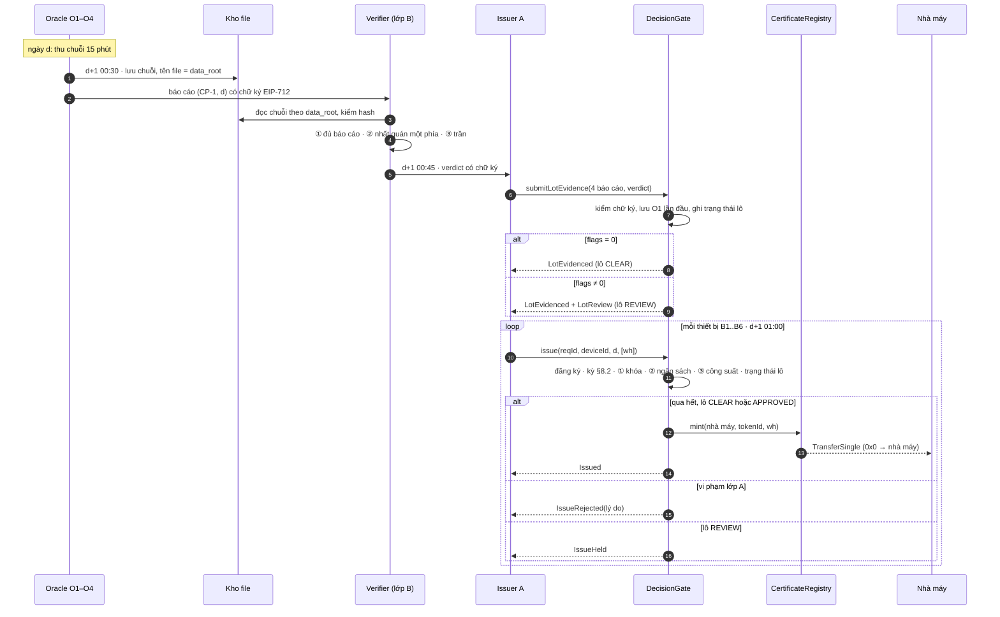
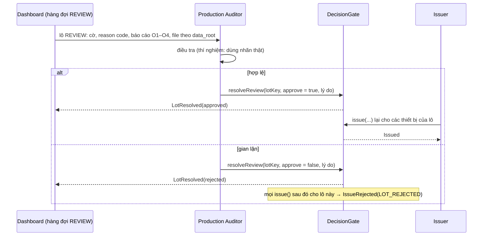

# Luồng chạy chi tiết và giao diện

Tài liệu thiết kế cho giai đoạn 3–5 (contract, lớp B, tích hợp, dashboard). Mô tả **ai gọi gì, theo thứ tự nào, trao đổi dữ liệu dạng gì**. Luật kiểm tra, ngưỡng và chỉ số nằm ở `SPEC.md`; danh sách module ở `PLAN.md`. Khi các tài liệu lệch nhau, SPEC là chuẩn.

## 1. Các vai và khóa

| Vai | Làm gì | Khóa ký |
|---|---|---|
| **Chủ nhà máy (registrant)** | Nhận chứng chỉ; chuyển nhượng; có thể retire | Địa chỉ ví của nhà máy |
| **Issuer** (`issuerA`, `issuerB`) | Đăng ký thiết bị; gửi bằng chứng của lô; gửi yêu cầu phát hành | Khóa issuer, có trong allowlist lúc deploy |
| **Oracle O1–O4** | Đo, đóng gói chuỗi 15 phút, ký báo cáo ngày | R1: khóa O1 thuộc điện lực. R2: khóa O1–O3 thuộc chủ dự án. O4 luôn thuộc issuer |
| **Verifier** | Chạy lớp B (off-chain) trên 4 báo cáo của một lô; ký verdict | Khóa verifier, thuộc issuer |
| **Production Auditor** | Phân xử lô REVIEW (duyệt hoặc bác); kiểm tra ngẫu nhiên p% số lô đã mint | Khóa auditor (on-chain chỉ dùng cho `resolveReview`) |
| **Code Manager** | Tạm khóa / mở khóa / rút chứng chỉ chưa retire (I-REC §11) | Khóa riêng, tách khỏi mọi issuer |
| **Bên mua** | Nhận chứng chỉ qua chuyển nhượng; retire khi dùng | Địa chỉ ví |
| **Kho file off-chain** | Lưu chuỗi 15 phút, tên file = `data_root` | Không ký; ai cũng kiểm được bằng cách tính lại hash |
| **Dashboard** | Đọc event on-chain và kho file để dựng lineage; giao diện cho auditor | Chỉ đọc (trừ màn hình auditor khi demo) |

Không vai nào được mint trực tiếp. Chỉ `DecisionGate` gọi được hàm mint của `CertificateRegistry`.

## 2. Định danh và mã hóa

- **Mã chuỗi → `bytes32`:** mã ASCII dài tối đa 31 ký tự (ví dụ `"B1"`, `"CP-1"`), đệm 0 bên phải (giống `ethers.encodeBytes32String`). Đọc lại được trên dashboard.
- **Ngày:** `uint32`, số ngày địa phương kể từ 1970-01-01 (`rec/timeutil.py`).
- **Năng lượng:** `uint64` Wh. **Bức xạ:** `uint64` Wh/m².
- **Khóa lô:** `lotKey = keccak256(abi.encode(cpId, day))`.
- **Định danh chứng chỉ:** `tokenId = uint256(keccak256(abi.encode(deviceId, day)))`.
- **`data_root` của một báo cáo:** `keccak256` của dãy giá trị theo thứ tự slot (nhãn cuối kỳ, UTC) của ngày đó, mỗi giá trị là `int64` big-endian, slot thiếu ghi `-1`. Với O1, O2 giá trị là Wh của slot; với O3, O4 là Wh/m² của slot. Ngày đổi giờ có 92 hoặc 100 slot. Mã hóa và hash nằm ở `rec/oracles/encoding.py`.
- **File trong kho:** `store/<data_root hex>.json` = `{oracle, cp, day, unit, slot_ends[], values[]}` (giá trị thiếu là `null`). Khi đọc, tính lại `data_root` từ `values`; lệch thì file bị coi là đã bị sửa.

## 3. Định dạng message có chữ ký (EIP-712)

Domain: `name = "REC-A5"`, `version = "1"`, `chainId = 31337`, `verifyingContract = DecisionGate`.

```
OracleReport(
  uint8   oracle,        // 1..4 = O1..O4
  bytes32 cpId,
  uint32  day,
  uint64  valueDay,      // O1, O2: Wh; O3, O4: Wh/m²
  uint64  maxSlot,       // giá trị slot lớn nhất trong ngày
  uint16  slotsPresent,  // số slot ban ngày có số liệu
  bytes32 dataRoot
)

Verdict(
  bytes32 lotKey,
  uint8   flags,         // bit 1 = thiếu báo cáo, bit 0 = không nhất quán, bit 2 = vượt trần
  uint64  ceilingWh,     // 0 nếu cấu hình không có trần (B1)
  uint16  sunSlots,      // số slot 15 phút có mặt trời trên đường chân trời (pvlib), dùng cho luật công suất
  bytes32 reportsHash,   // keccak256 của 4 struct-hash OracleReport theo thứ tự O1..O4: gắn verdict với đúng 4 báo cáo
  bytes32 modelHash,     // hash của mô hình và ngưỡng đã khóa
  bytes32 reasonsHash    // hash của file reason code trong kho
)
```

Giá trị `flags` khớp với `rec.schema.Flag` (`INCONSISTENT = 1`, `MISSING_REPORT = 2`, `OVER_CEILING = 4`). Contract kiểm tra: chữ ký báo cáo thuộc oracle được phép cho (oracle, CP); chữ ký verdict thuộc verifier được phép; `reportsHash` khớp 4 báo cáo được gửi kèm.

## 4. Luồng chính: một lô, từ đo đến chứng chỉ

Ví dụ ngày d, CP-1 có 6 thiết bị B1–B6 đăng ký ở `issuerA`. Giờ là giờ địa phương theo đồng hồ mô phỏng (SPEC mục 1).



Các bước:

1. **Thu số liệu (ngày d).** Mỗi oracle gom chuỗi 15 phút cho CP-1.
2. **Báo cáo (d+1, 00:30).** Mỗi oracle tính `valueDay`, `maxSlot`, `slotsPresent`, `dataRoot`; lưu file vào kho; ký `OracleReport`; gửi cho verifier.
3. **Lớp B (d+1, 00:45).** Verifier đọc lại chuỗi từ kho, kiểm hash, rồi chạy ba bước theo cấu hình (B1, B2, Proposed; SPEC mục 6.2). Kết quả là `Verdict` kèm file reason code trong kho. Cấu hình B1 chỉ đặt `sunSlots`, không bật cờ nào. Tham số và ngưỡng của lớp B được đọc từ `artifacts/model/<biến thể>/layer_b.json`. Mặc định là `prereg`, đúng `spec-v1`; biến thể hậu kiểm `day_only` bỏ thống kê nhất quán theo slot (`manifests/CHANGES.md`). Hash mô hình trong `Verdict` lấy từ file này.
4. **Gửi bằng chứng của lô.** Issuer gọi `submitLotEvidence` **một lần cho mỗi lô**. Contract:
   - kiểm chữ ký 4 báo cáo, chữ ký verdict và `reportsHash`;
   - lưu O1 của (CP, ngày) ở lần đầu; nếu đã có O1 khác thì phát `O1Conflict` và từ chối;
   - đặt trạng thái lô: `CLEAR` nếu `flags = 0`, ngược lại là `REVIEW`.
5. **Yêu cầu phát hành (d+1, 01:00).** Issuer gọi `issue` cho từng thiết bị. Contract kiểm theo thứ tự:
   1. người gọi là issuer hiện tại của thiết bị; thiết bị đang có đăng ký hiệu lực;
   2. kỳ phát hành theo §8.2 (≤ 1 năm, trong một năm dương lịch, không trước ngày đăng ký hiệu lực, không sau ngày đóng đăng ký, không sau thời điểm nộp);
   3. ① khóa: (thiết bị, ngày) chưa phát hành;
   4. ② ngân sách: `issued[cp][day] + wh ≤ O1`;
   5. ③ công suất: `wh ≤ công suất thiết bị × sunSlots × 0,25 h`, và `maxSlot` của O1 ≤ công suất CP × 0,25 h;
   6. trạng thái lô: `CLEAR` hoặc `APPROVED` thì MINT; `REVIEW` thì giữ lại; `REJECTED` thì từ chối.
6. **Kết cục.**
   - MINT: đánh dấu khóa, cộng ngân sách, mint cho địa chỉ nhà máy, phát `Issued`.
   - Vi phạm lớp A: **không revert**, mà phát `IssueRejected(reqId, lý do)` để lý do được lưu công khai. Chỉ revert khi người gọi không có quyền hoặc dữ liệu sai định dạng.
   - Lô REVIEW: phát `IssueHeld`, không lưu yêu cầu. Issuer gửi lại sau khi auditor duyệt.
   - Yêu cầu nhiều ngày (D2) đi qua các bước trên cho từng ngày trong kỳ; chỉ cần một ngày vi phạm là cả yêu cầu bị từ chối.

## 5. Nhánh REVIEW: auditor phân xử (cách B)



- Trong mô phỏng, auditor xử lý hàng đợi lúc 23:00 ngày d+1. Lô trung thực bị REVIEW nhầm chỉ bị **giữ tạm** (khoảng một ngày), không mất chứng chỉ.
- `resolveReview` chỉ đổi trạng thái lô, không mint.

## 6. Nhánh kiểm tra ngẫu nhiên → Code Manager

```mermaid
sequenceDiagram
    participant AU as Production Auditor
    participant CM as Code Manager
    participant CR as CertificateRegistry

    AU->>AU: d+2 · bốc thăm p% số lô đã MINT
    alt lô bị bốc trúng là gian lận
        AU->>CM: báo cáo kèm bằng chứng
        CM->>CR: suspend(tokenId, lý do) cho các chứng chỉ của lô
        CM->>CR: withdraw(tokenId, holder, wh, lý do)
        CR-->>CR: burn phần chưa retire; trả lại ngân sách CP; rút hết thì mở lại khóa
        Note over CR: event Suspended, Withdrawn, kèm lý do, công khai
    end
```

- Phần đã retire trước khi bị phát hiện thì **không rút được**, và tính là lọt (SPEC mục 8.2).
- Rút toàn bộ một thiết bị-ngày thì khóa (thiết bị, ngày) được mở lại; issuer có thể phát hành lại lượng đúng qua luồng chính.

## 7. Chuyển nhượng và retire

1. **Chuyển nhượng:** người giữ gọi `safeTransferFrom(from, to, tokenId, wh, "")` của ERC-1155. Có thể chuyển nhiều lần (nhà máy → bên mua → bên mua khác). Revert nếu chứng chỉ đang bị tạm khóa. Thanh toán nằm ngoài phạm vi.
2. **Retire (redemption, I-REC §10):** người **đang giữ** gọi `retire(tokenId, wh, beneficiary, purpose, consumptionLocation, reportingPeriod)` khi dùng chứng chỉ. Contract burn `wh` khỏi người gọi và phát `Retired(...)` với đủ các trường. Không đảo ngược, không sửa được. Revert nếu đang bị tạm khóa, hoặc người gọi không giữ đủ.
3. **Sau khi retire:** không chuyển nhượng, không retire lại được, vì token đã bị đốt (chặn D6). Event `Retired` là bằng chứng của tuyên bố, và dashboard dùng nó làm "redemption statement".

## 8. Đăng ký, chuyển đăng ký, đóng đăng ký

| Thao tác | Ai gọi | Kiểm tra | Event |
|---|---|---|---|
| `registerDevice(deviceId, cpId, capacityW, effectiveDay, isGroup, memberCount)` | Issuer | Mã chưa tồn tại (D3 bị chặn ở đây, revert `DuplicateDevice`); nhóm thì `capacity ≤ 5 MW` và `memberCount ≤ 50` (§7.7) | `DeviceRegistered` |
| `transferRegistration(deviceId, newIssuer, effectiveDay)` | Issuer hiện tại | `newIssuer` trong allowlist; giữ nguyên mã (§16.3) | `RegistrationTransferred` |
| `closeRegistration(deviceId, endDay)` | Issuer hiện tại | `endDay ≥ effectiveDay` | `RegistrationClosed` |

Từ `effectiveDay` của lần chuyển đăng ký, chỉ issuer mới được gửi yêu cầu cho thiết bị đó.

## 9. Giao diện contract

### `DeviceRegistry`

Các hàm ở mục 8, cùng `deviceOf(deviceId) → (cpId, issuer, capacityW, effectiveDay, endDay, isGroup)`.

### `DecisionGate`

| Hàm | Ai gọi | Kết quả |
|---|---|---|
| `submitLotEvidence(OracleReport[4], bytes[4] reportSigs, Verdict, bytes verdictSig)` | Issuer | Lưu O1, trạng thái lô; `LotEvidenced`, có thể kèm `LotReview` hoặc `O1Conflict` |
| `issue(bytes32 reqId, bytes32 deviceId, uint32 dayStart, uint64[] whPerDay)` | Issuer hiện tại của thiết bị | `Issued`, `IssueRejected` hoặc `IssueHeld` |
| `resolveReview(bytes32 lotKey, bool approve, bytes32 reasonHash)` | Auditor | `LotResolved`; lô `REVIEW` → `APPROVED` / `REJECTED` |
| `lotState(lotKey) → (o1Wh, maxSlot, sunSlots, flags, status)` | Ai cũng đọc được | — |

Trạng thái lô: `NONE → CLEAR` hoặc `NONE → REVIEW → APPROVED | REJECTED`.

### `CertificateRegistry` (ERC-1155, đơn vị Wh)

| Hàm | Ai gọi | Ghi chú |
|---|---|---|
| `mint(to, tokenId, wh, cpId, deviceId, day)` | Chỉ `DecisionGate` | Đánh dấu khóa (thiết bị, ngày), cộng `issued[cp][day]`; revert nếu vi phạm (lớp bảo vệ thứ hai, dù gate có lỗi) |
| `safeTransferFrom(...)` | Người giữ | Revert nếu đang bị tạm khóa |
| `retire(tokenId, wh, beneficiary, purpose, consumptionLocation, reportingPeriod)` | Người giữ | Burn + `Retired` |
| `suspend(tokenId, bool active, string reason)` | Code Manager | `Suspended` |
| `withdraw(tokenId, holder, wh, string reason)` | Code Manager | Chỉ phần chưa retire; trả lại ngân sách; rút hết thì mở lại khóa; `Withdrawn` |

### Event

| Contract | Event |
|---|---|
| DeviceRegistry | `DeviceRegistered(deviceId, cpId, issuer, capacityW, effectiveDay, isGroup)`; `RegistrationTransferred(deviceId, from, to, effectiveDay)`; `RegistrationClosed(deviceId, endDay)` |
| DecisionGate | `LotEvidenced(lotKey, cpId, day, o1Wh, flags, verdictHash, dataRoots[4])`; `LotReview(lotKey, flags, reasonsHash)`; `LotResolved(lotKey, approved, auditor, reasonHash)`; `O1Conflict(lotKey, storedWh, offeredWh)`; `Issued(reqId, tokenId, deviceId, day, wh, to)`; `IssueRejected(reqId, deviceId, day, reason)`; `IssueHeld(reqId, lotKey)` |
| CertificateRegistry | `TransferSingle` (ERC-1155); `Retired(tokenId, holder, wh, beneficiary, purpose, consumptionLocation, reportingPeriod)`; `Suspended(tokenId, active, reason)`; `Withdrawn(tokenId, holder, wh, reason)` |

Mã lý do của `IssueRejected` khớp `rec.schema.RejectReason`: `KEY`, `BUDGET`, `CAPACITY`, `PERIOD`, `ORACLE`, `LOT_REJECTED`, cùng `NOT_ISSUER` / `NOT_REGISTERED` cho lỗi đăng ký.

## 10. B0 (SQLite) đi theo cùng giao diện

`rec/registry/base.py` định nghĩa interface `Registry` với cùng các thao tác: `register_device`, `transfer_registration`, `close_registration`, `submit_lot_evidence`, `resolve_review`, `issue`, `transfer`, `retire`, `suspend`, `withdraw`. Có ba bản cài đặt:

| Backend | Lưu ở | Khác biệt |
|---|---|---|
| `b0_separate` | Mỗi issuer một file SQLite | Khóa, ngân sách, vòng đời chỉ thấy dữ liệu của issuer đó. `reconcile()` mỗi T_rec ngày gộp các file, chạy lại khóa và ngân sách CP, ghi lại bản trùng phát hiện được cùng thời điểm phát hiện |
| `b0_shared` | Một file SQLite | Cùng kiểm tra như contract |
| `chain` | Hardhat qua web3.py | Gọi đúng các hàm ở mục 9 |

Chỉ hai backend SQLite có `operator_edit` (UPDATE / DELETE / phát hành lại, không để dấu vết) để chạy kịch bản insider. Trên chain không có thao tác tương đương; thứ gần nhất là `withdraw` của Code Manager, và nó luôn để lại event.

## 11. Bộ chạy mô phỏng (`rec/experiments/runner.py`)

**Đầu vào:** `events.jsonl` của generator (sắp theo `t`), tên backend, cấu hình lớp B (B1, B2, Proposed, A1, A2), chế độ (R1 / R2), tỉ lệ kiểm tra ngẫu nhiên p.

**Vòng lặp theo đồng hồ mô phỏng:**

| Thời điểm | Việc |
|---|---|
| `register` / `transfer_registration` / `deregister` | Gọi hàm tương ứng của backend |
| `report` (d+1 00:30) | Lưu file vào kho; gom đủ 4 báo cáo của (CP, d) |
| d+1 00:45 | Verifier chạy lớp B → verdict; issuer gọi `submit_lot_evidence` |
| `request` (d+1 01:00) | Gọi `issue`; ghi kết quả vào nhật ký quyết định |
| d+1 23:00 | Auditor mô phỏng xử lý hàng đợi REVIEW theo nhãn thật; issuer gửi lại các yêu cầu bị giữ của lô được duyệt |
| d+2 | Kiểm tra ngẫu nhiên p% số lô đã MINT; lô gian lận bị bốc trúng → Code Manager `suspend` rồi `withdraw` |
| `transfer` / `retire` | Gọi hàm tương ứng |
| `operator_edit` | Chỉ backend SQLite |
| Mỗi T_rec ngày | `b0_separate.reconcile()` |

- **Thời gian trên chain:** trước mỗi giao dịch, gọi `evm_setNextBlockTimestamp` của Hardhat để block khớp đồng hồ mô phỏng; nhờ đó luật "không yêu cầu cho kỳ sau thời điểm nộp" và exposure window có nghĩa. E3 dùng chế độ đào block mỗi 2 giây để đo độ trễ.
- **Nhật ký quyết định** (`artifacts/runs/<run>/decisions.csv`): `t, backend, config, req_id, lot_key, decision, reason, wh, tx_hash, gas`. `rec/metrics` chỉ đọc file này cùng file nhãn.
- **E2 chạy off-chain:** cùng runner, nhưng backend là `gate/sim.py` (cài lại lớp A bằng Python). **Test parity** chạy một mẫu ca qua cả `chain` lẫn `gate/sim.py`, và đòi nhật ký quyết định trùng nhau 100%.

## 12. Dashboard (`dashboard/app.py`)

| Màn hình | Nội dung | Đọc từ |
|---|---|---|
| Tổng quan | Số lô theo ngày: MINT / REJECT / REVIEW / bị rút; tổng MWh đã phát hành, đã retire | Event `Issued`, `IssueRejected`, `LotReview`, `Withdrawn`, `Retired` |
| Tra chứng chỉ | Nhập `tokenId` hoặc (thiết bị, ngày) → lineage: đăng ký thiết bị → bằng chứng của lô (4 báo cáo, nút "kiểm hash" so file trong kho với `data_root`) → verdict và reason code → `Issued` → các lần chuyển nhượng → `Retired` hoặc `Withdrawn` | Event của cả 3 contract; kho file |
| Hàng đợi REVIEW | Lô đang REVIEW: cờ, reason code; biểu đồ O1 so với O2, E₃ và trần trong ngày; nút duyệt / bác (khi demo, ký bằng khóa auditor) | `LotReview`, `lotState`; kho file |
| Nhật ký công khai | Mọi `IssueRejected` kèm lý do; mọi thao tác của Code Manager kèm lý do; `O1Conflict` | Event |
| Lineage completeness | % chứng chỉ dựng lại được đủ chuỗi chỉ từ event và kho file | Như trên |

## 13. Test kiểm luồng

| Test | Kiểm |
|---|---|
| `contracts/test/flow.ts` | Luồng chính một lô sạch: 6 thiết bị được MINT; tổng = O1 |
| `contracts/test/review.ts` | Lô REVIEW: `IssueHeld`; auditor duyệt → MINT; auditor bác → `IssueRejected(LOT_REJECTED)`; người khác gọi `resolveReview` → revert |
| `contracts/test/code_manager.ts` | Tạm khóa chặn chuyển nhượng và retire; `withdraw` trả lại ngân sách và mở lại khóa; không rút được chứng chỉ đã retire; Code Manager không mint được |
| `contracts/test/irec_*.ts` | Mỗi điều khoản trong `COMPLIANCE.md` (tên test mang mã điều khoản) |
| `tests/test_encoding.py` | `data_root` giống nhau giữa Python và Solidity; slot thiếu mã hóa `-1`; ngày đổi giờ 92/100 slot |
| `tests/test_parity.py` | Nhật ký quyết định của `chain` và `gate/sim.py` trùng nhau |
